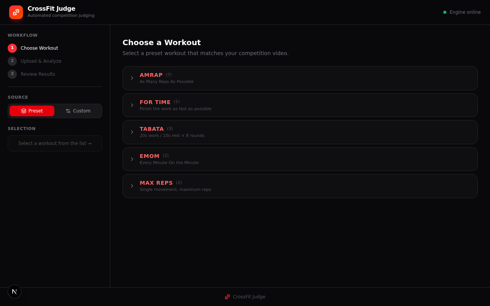
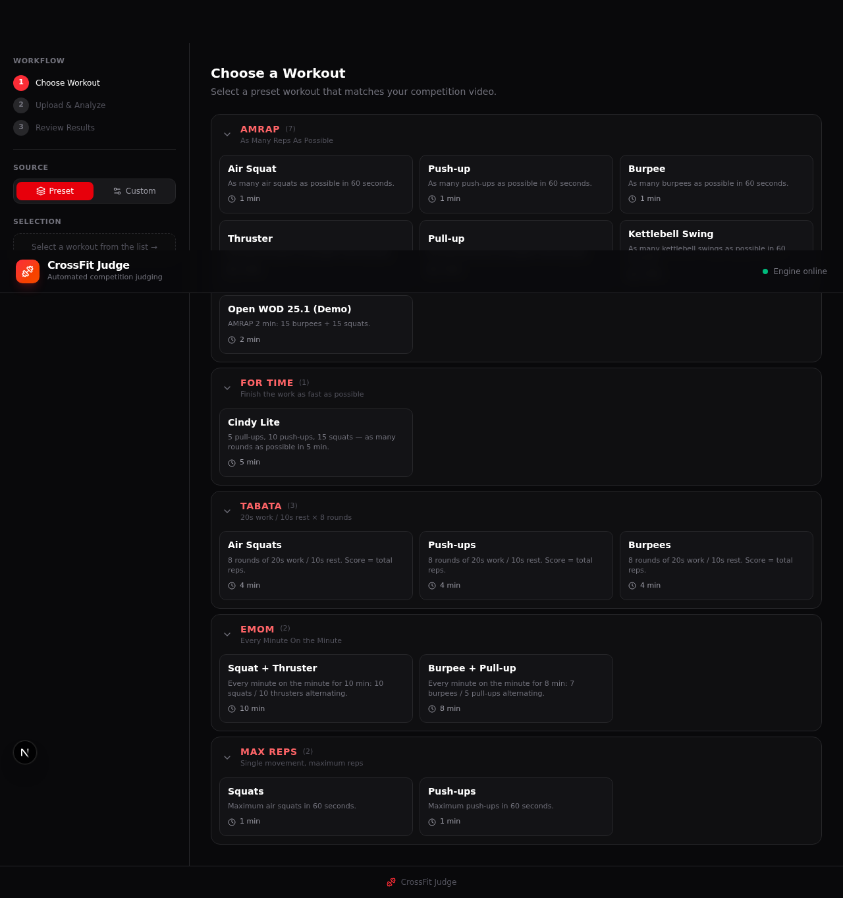
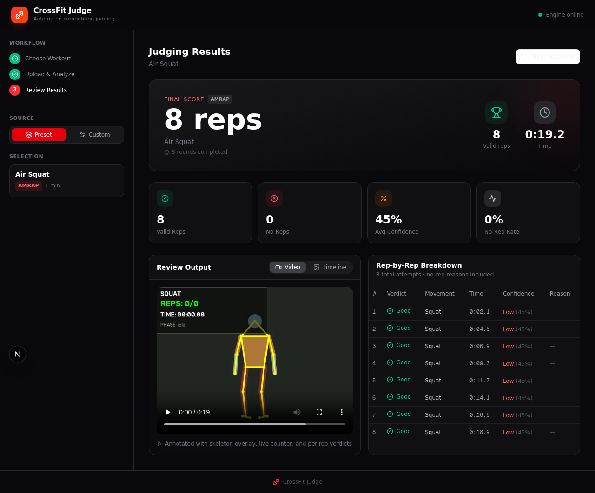
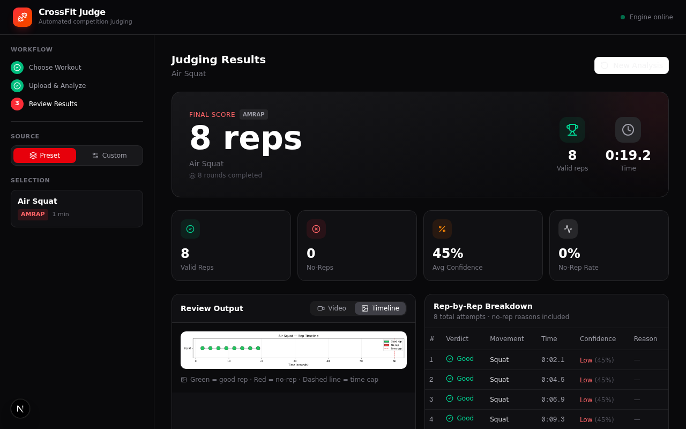
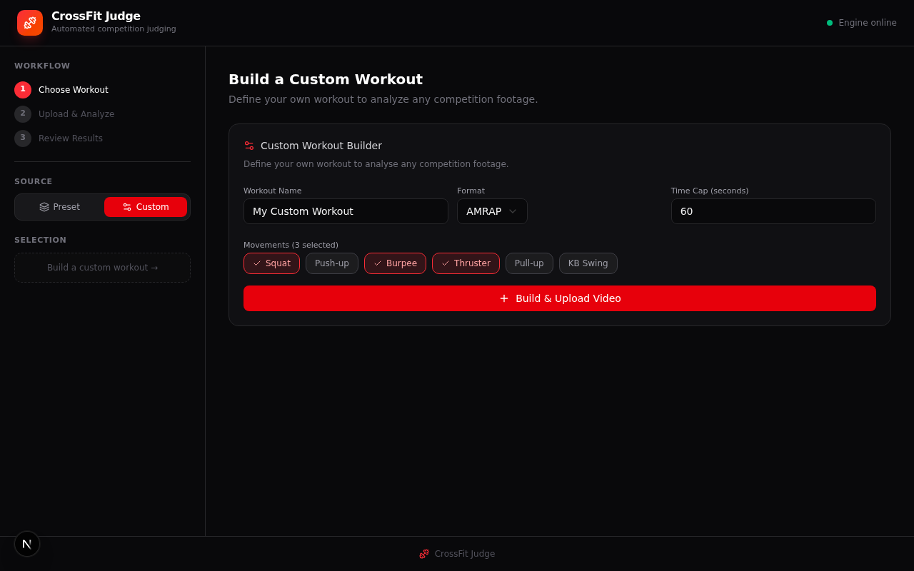

# 🏋️ CrossFit Judge

**AI-powered CrossFit competition judge** — automatically detects movements, counts valid reps, and scores athletes according to [CrossFit Games](https://games.crossfit.com/) standards.

Built with MediaPipe Pose, OpenCV, FastAPI, and Next.js.

---

## 📋 Table of Contents

- [Motivation](#-motivation)
- [How It Works](#-how-it-works)
- [Features](#-features)
- [Screenshots](#-screenshots)
- [Quick Start](#-quick-start)
- [Workout Formats](#-workout-formats)
- [Movement Standards](#-movement-standards)
- [Project Structure](#-project-structure)
- [Roadmap](#-roadmap)
- [Contributing](#-contributing)
- [License](#-license)

---

## 🎯 Motivation

CrossFit has been growing rapidly in Iran, with national leagues and online qualifiers attracting hundreds of athletes. In online competitions, athletes record themselves performing prescribed workouts and submit videos for judging. Judges then have to review **hundreds of videos** — each 5 to 20 minutes long — checking every single rep for movement standards.

This is slow, exhausting, and inconsistent work for human judges.

**CrossFit Judge** was built to solve this problem. As a second-year computer engineering student passionate about both sports and AI, I wanted to create a tool that:

1. **Automates rep counting** — counts only valid reps that meet CrossFit Games movement standards
2. **Provides transparent feedback** — explains exactly *why* a rep was rejected (no-rep reason)
3. **Generates reviewable evidence** — produces an annotated video with skeleton overlay, live counter, and per-rep verdicts that human judges can review
4. **Handles competition scale** — supports chunked uploads for long videos and disk-persistent jobs that survive server restarts

This is **v1** — a working foundation that will continue to evolve with more movements, better accuracy, and additional features.

---

## 🔧 How It Works

```
┌─────────────┐     ┌──────────────┐     ┌─────────────┐     ┌──────────────┐     ┌────────────┐
│  Video      │ ──> │  Pose        │ ──> │  Movement   │ ──> │   Judging    │ ──> │  Report    │
│  Upload     │     │  Detection   │     │  Analysis   │     │   Engine     │     │  + Video   │
│ (chunked)   │     │ (MediaPipe)  │     │ (per move)  │     │ (standards)  │     │ (annotated)│
└─────────────┘     └──────────────┘     └─────────────┘     └──────────────┘     └────────────┘
                                               │
                                        ┌──────┴──────┐
                                        │  Timer +    │
                                        │  Time Cap   │
                                        │  Checker    │
                                        └─────────────┘
```

1. **Video Upload** — the athlete uploads a competition video (chunked into 5MB pieces for reliability)
2. **Pose Detection** — MediaPipe Pose extracts 33 body landmarks from each frame
3. **Movement Analysis** — each movement detector runs a state machine (IDLE → DESCENDING → BOTTOM → ASCENDING) to count rep cycles
4. **Standards Checking** — every rep is validated against CrossFit Games movement standards
5. **Scoring** — the scoring engine calculates the final score based on the workout format (AMRAP, For Time, Tabata, EMOM, Max Reps)
6. **Report Generation** — an annotated video (skeleton + counter + verdicts), a timeline chart, and a JSON report are produced

---

## ✨ Features

### Core
- **6 movements**: Squat, Push-up, Burpee, Thruster, Pull-up, Kettlebell Swing
- **5 workout formats**: AMRAP, For Time, Tabata, EMOM, Max Reps — scored per CrossFit Games standards
- **15 preset workouts** + **custom workout builder** (define your own movements, format, and time cap)
- **Movement sequencing** — for multi-movement workouts, only the expected movement's detector runs (prevents cross-detection)
- **Per-rep confidence scoring** — each rep gets a 0-100% confidence rating
- **No-rep reasons** — clear, specific feedback for every rejected rep

### Output
- **Annotated video** — skeleton overlay with live rep counter, timer, and per-rep verdict badges
- **Rep timeline** — visual chart of every rep attempt over time (green = good, red = no-rep)
- **Rep breakdown table** — rep-by-rep verdicts with timestamps, confidence, and no-rep reasons
- **H.264 transcoding** — annotated video is transcoded via ffmpeg for browser playback

### Infrastructure
- **Chunked uploads** — handles large videos (5/10/15+ minutes) by splitting into 5MB chunks
- **Disk-persistent jobs** — job state survives server restarts (no lost results)
- **Subprocess isolation** — analysis runs in a separate process so MediaPipe crashes don't kill the server
- **Stale job detection** — automatically marks jobs as failed if they hang

---

## 📸 Screenshots

### Collapsed Categories


### All Categories Expanded


### Results Dashboard


### Rep Timeline


### Custom Workout Builder


---

## 🚀 Quick Start

### Prerequisites

- **Python 3.10+** (tested with 3.12)
- **Node.js 18+** with **bun** (or npm)
- **ffmpeg** (for video transcoding to H.264)
- **4GB+ RAM** (MediaPipe is memory-intensive)

### 1. Python Backend Setup

```bash
cd mini-services/crossfit-judge
chmod +x setup.sh
./setup.sh
```

This will:
- Install Python dependencies (mediapipe, opencv, fastapi, etc.)
- Download the MediaPipe pose model
- Create data directories

### 2. Start the Python Server

```bash
cd mini-services/crossfit-judge
python3 main.py
```

The server runs on **http://localhost:8001**.

### 3. Start the Next.js Frontend

In a separate terminal:

```bash
bun install
bun run dev
```

Or with npm:

```bash
npm install
npm run dev
```

The frontend runs on **http://localhost:3000**.

### 4. Open the App

Go to **http://localhost:3000** in your browser.

---

## 🏆 Workout Formats (CrossFit Games Standards)

| Format | Scoring | Example |
|--------|---------|---------|
| **AMRAP** | Total valid reps in time cap (more = better) | `47 reps` |
| **For Time** | Time to complete all prescribed work (lower = better); DNF if not finished | `8:32` or `47 reps (DNF)` |
| **Tabata** | Total reps across 8 rounds (20s work / 10s rest) | `89 reps` |
| **EMOM** | Total reps completed (Every Minute On the Minute) | `72 reps` |
| **Max Reps** | Maximum valid reps in time cap | `53 reps` |

---

## 📐 Movement Standards

### Squat
- **Bottom**: Hip crease below knee (knee angle ≤ 95°)
- **Top**: Full hip and knee extension (knee angle ≥ 165°)

### Push-up
- **Bottom**: Chest touches ground
- **Top**: Full arm lockout (elbow angle ≥ 155°)

### Burpee
- **Bottom**: Chest and thighs on ground (descent ratio ≥ 35%)
- **Top**: Jump with feet off ground **AND** hands overhead

### Thruster
- **Bottom**: Deep squat (knee angle ≤ 95°)
- **Top**: Full knee extension + overhead lockout (elbow ≥ 150°)

### Pull-up
- **Top**: Chin above bar
- **Bottom**: Full extension / dead hang (elbow angle ≥ 150°)

### Kettlebell Swing
- **Bottom**: Hip hinge (hip angle ≤ 95°)
- **Top**: Bell reaches target height + full hip extension (≥ 150°)

---

## 📁 Project Structure

```
crossfit-judge/
├── mini-services/crossfit-judge/       # Python AI engine
│   ├── main.py                         # FastAPI server (port 8001)
│   ├── worker.py                       # Analysis subprocess
│   ├── setup.sh                        # First-time setup
│   ├── requirements.txt                # Python dependencies
│   ├── config/
│   │   ├── settings.py                 # Thresholds and configuration
│   │   └── workouts.py                 # Workout definitions
│   ├── core/
│   │   ├── analyzer.py                 # Main analysis pipeline
│   │   ├── pose_detector.py            # MediaPipe wrapper
│   │   ├── video_processor.py          # OpenCV + H.264 transcoding
│   │   ├── timer.py                    # Workout timer
│   │   └── sequence.py                 # Multi-movement sequencing
│   ├── movements/                      # Movement detectors
│   │   ├── base_movement.py            # State machine base class
│   │   ├── squat.py
│   │   ├── pushup.py
│   │   ├── burpee.py
│   │   ├── thruster.py
│   │   ├── pullup.py
│   │   └── kettlebell_swing.py
│   ├── judging/
│   │   └── scorer.py                   # CrossFit Games scoring
│   ├── reporting/
│   │   ├── video_annotator.py          # Skeleton overlay
│   │   ├── timeline.py                 # Rep timeline chart
│   │   └── report_generator.py         # JSON report
│   └── tests/
│       └── test_synthetic.py           # Self-test
├── src/                                # Next.js frontend
│   ├── app/
│   │   ├── page.tsx                    # Main UI
│   │   └── api/judge/[...path]/        # Proxy to Python backend
│   ├── components/
│   │   ├── crossfit/                   # App-specific components
│   │   └── ui/                         # shadcn/ui components
│   └── lib/
│       ├── crossfit-api.ts             # API client
│       └── python-server.ts            # Python process manager
└── package.json                        # Next.js dependencies
```

---

## 🗺️ Roadmap

CrossFit Judge is an active project under continuous development. Here's what's planned:

### v1 (Current)
- ✅ 6 core movements (Squat, Push-up, Burpee, Thruster, Pull-up, KB Swing)
- ✅ 5 workout formats (AMRAP, For Time, Tabata, EMOM, Max Reps)
- ✅ Custom workout builder
- ✅ Annotated video + timeline + rep breakdown
- ✅ Chunked uploads + disk-persistent jobs

### v2 (Planned)
- 📋 **More movements**: Box Jump, Wall Ball, Double Under, Toes-to-Bar, Muscle-up, Snatch, Clean & Jerk
- 📋 **Improved accuracy**: better calibration for different body types and camera angles
- 📋 **Multi-angle support**: use two camera angles (front + side) for better depth perception
- 📋 **Real-time feedback mode**: live webcam analysis for training (not just post-hoc review)

### v3 (Future)
- 📋 **Athlete profiles**: track progress across competitions
- 📋 **Judge override panel**: let human judges review and override AI verdicts
- 📋 **Competition dashboard**: manage multiple athletes and leaderboards
- 📋 **Mobile app**: for athletes to record and upload from their phone

---

## 🤝 Contributing

This is an open project. If you'd like to contribute:

1. Fork the repository
2. Create a feature branch (`git checkout -b feature/new-movement`)
3. Commit your changes (`git commit -am 'Add new movement detector'`)
4. Push to the branch (`git push origin feature/new-movement`)
5. Open a Pull Request

### Adding a New Movement

1. Create a new file in `mini-services/crossfit-judge/movements/` (e.g., `box_jump.py`)
2. Subclass `BaseMovement` and implement `_key_signals()`, `_classify_phase()`, and `_validate()`
3. Register the movement in `movements/__init__.py`
4. Add workout definitions in `config/workouts.py`

---

## 📄 License

MIT — Free to use for CrossFit competitions and training.

---

## 🙏 Acknowledgments

- [MediaPipe](https://developers.google.com/mediapipe) by Google — pose detection
- [OpenCV](https://opencv.org/) — video processing
- [CrossFit Games](https://games.crossfit.com/) — movement standards reference
- [shadcn/ui](https://ui.shadcn.com/) — UI components
